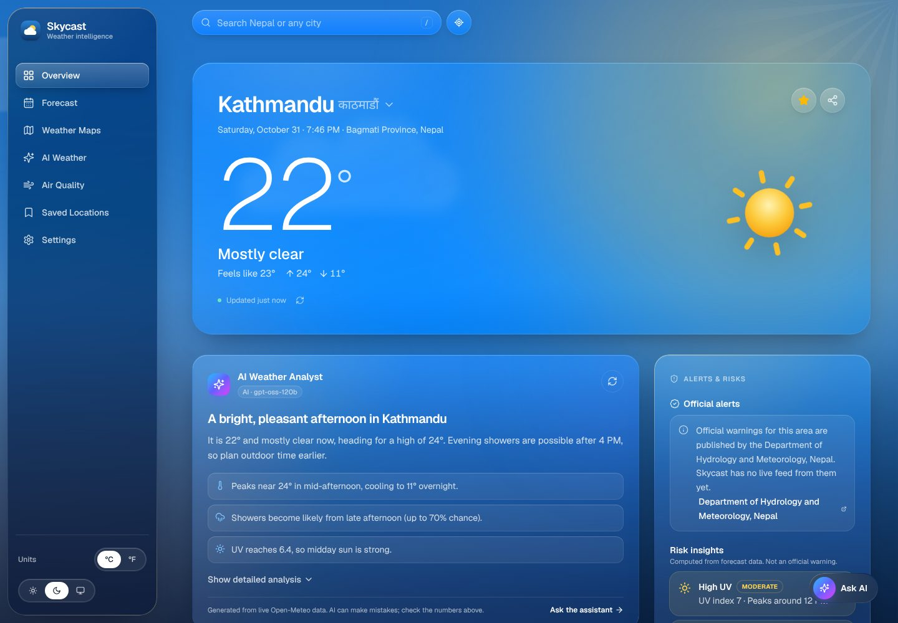
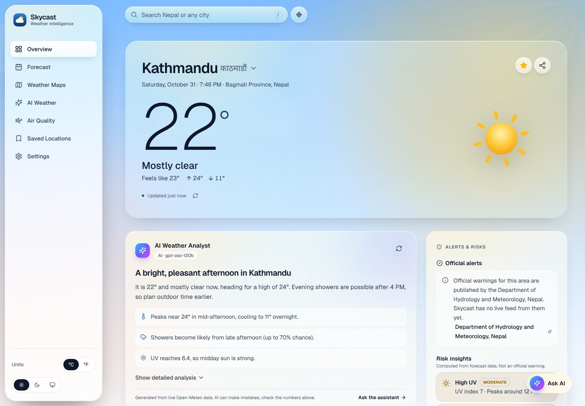
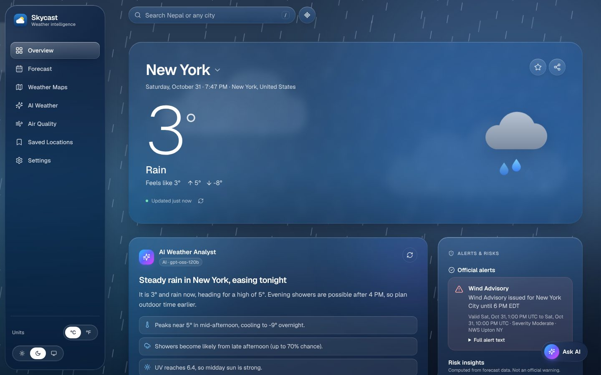
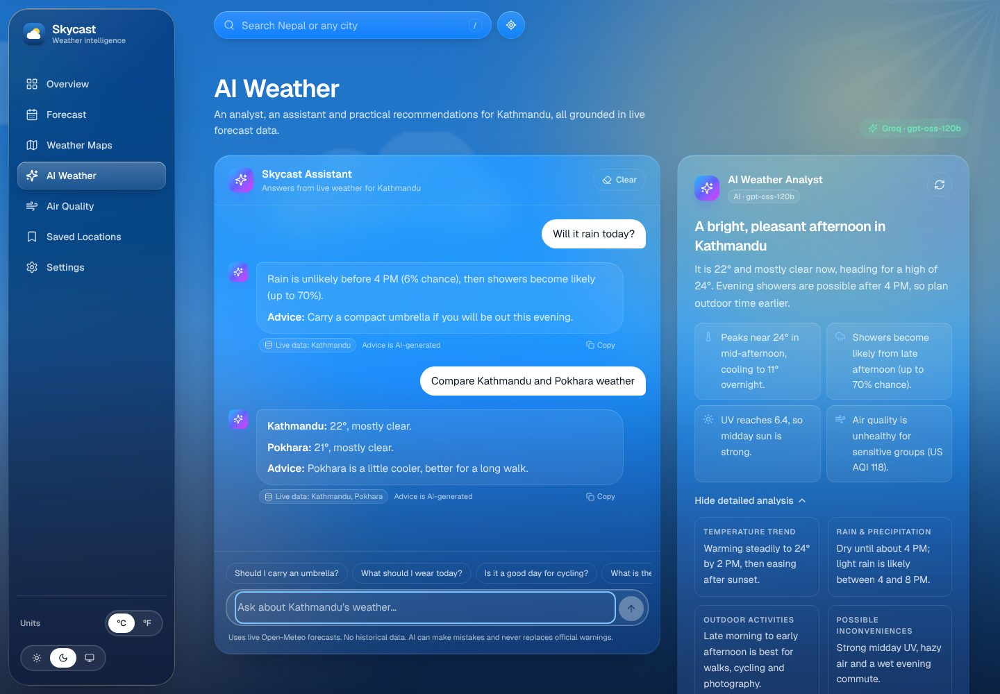
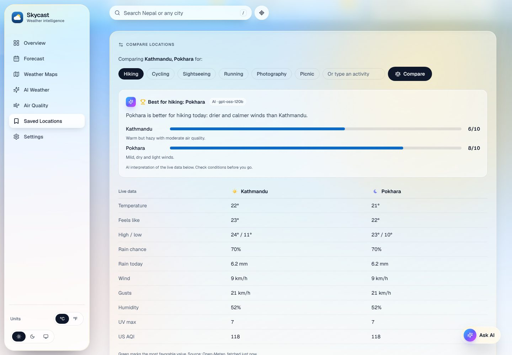
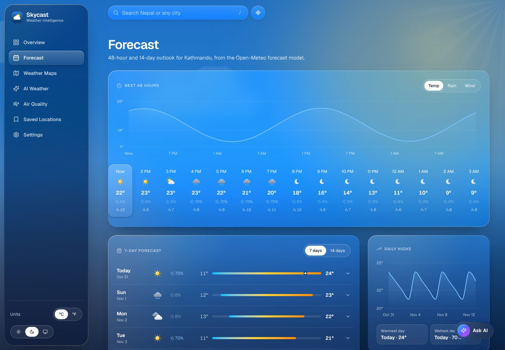
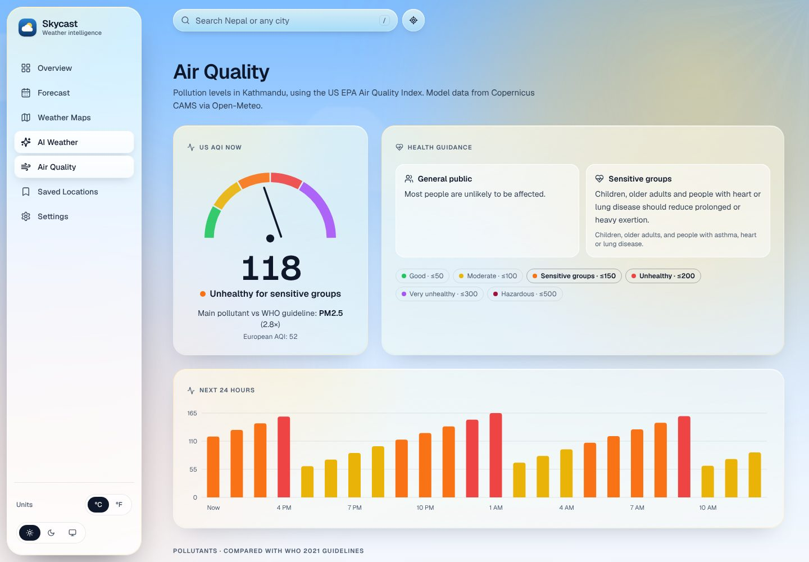
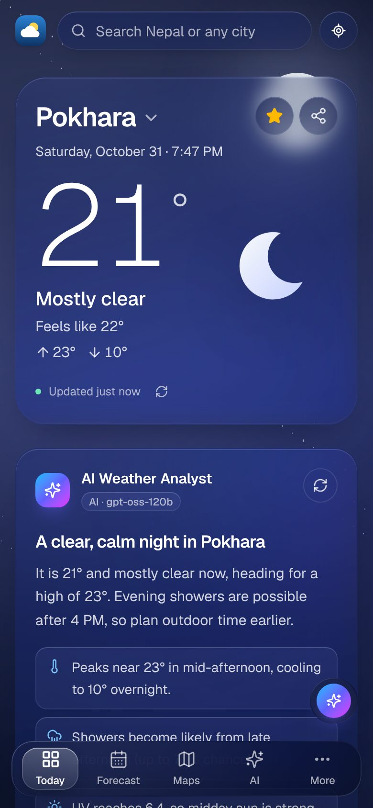
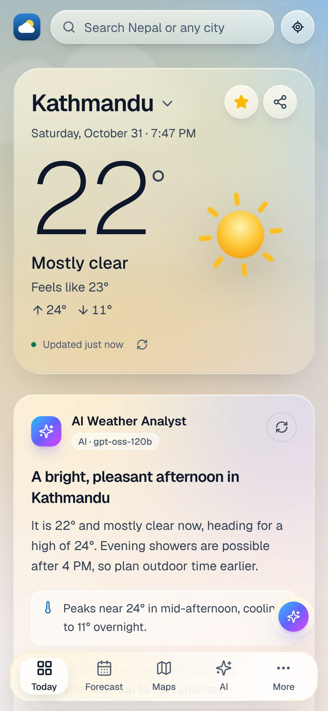
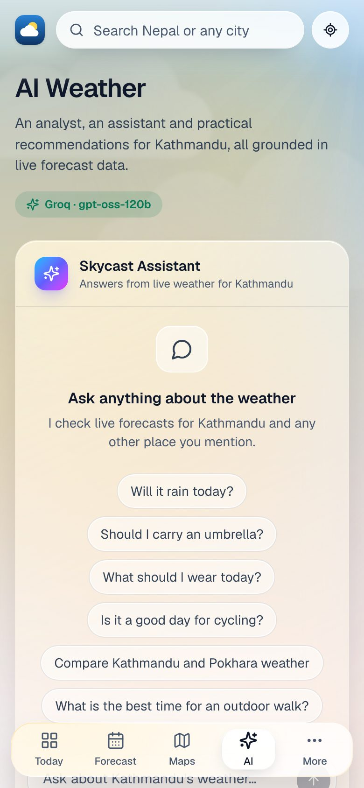

<div align="center">


# Skycast

**Weather intelligence for Nepal and the world.**
Live forecasts, radar, air quality and an AI assistant that explains the weather without making it up,
wrapped in an Apple Liquid Glass-inspired interface.

[](https://weather-app-six-ochre-71.vercel.app/)


<br />



</div>

<br />

## ✨ Highlights

<table>
  <tr>
    <td width="50%" valign="top">
      <h3>🌤️ Immersive weather scenes</h3>
      Animated skies for sun, cloud, rain, storm, snow, fog and night, with stars, drifting clouds, falling rain
      and lightning. The whole interface retints itself to match the weather outside.
    </td>
    <td width="50%" valign="top">
      <h3>🪟 Liquid Glass design</h3>
      Layered frosted glass with specular edges, reflections that follow your cursor, a progressive-blur header
      and a weather-aware tint: golden for sun, cool frost for rain, navy for night.
    </td>
  </tr>
  <tr>
    <td valign="top">
      <h3>🤖 AI that sticks to the facts</h3>
      A Groq-powered analyst, a streaming chat assistant and lifestyle tips. Every answer is grounded in live
      forecast data, and invented numbers are filtered out before you see them.
    </td>
    <td valign="top">
      <h3>🇳🇵 Built for Nepal</h3>
      Opens on Kathmandu, ranks Nepali places first in search, shows names in Devanagari (काठमाडौं, पोखरा) and
      tracks 12 cities from Dhangadhi to Namche Bazaar at a glance.
    </td>
  </tr>
</table>

## 📸 Screenshots

<table>
  <tr>
    <td width="50%"><p align="center"><sub><b>Overview · light mode</b></sub></p></td>
    <td width="50%"><p align="center"><sub><b>Rain scene with an official NWS alert</b></sub></p></td>
  </tr>
  <tr>
    <td><p align="center"><sub><b>AI assistant and analyst</b></sub></p></td>
    <td><p align="center"><sub><b>Compare places for an activity</b></sub></p></td>
  </tr>
  <tr>
    <td><p align="center"><sub><b>48-hour and 14-day forecast</b></sub></p></td>
    <td><p align="center"><sub><b>Air quality with WHO guideline comparison</b></sub></p></td>
  </tr>
</table>

<table>
  <tr>
    <td width="33%"><p align="center"><sub><b>Night · mobile</b></sub></p></td>
    <td width="33%"><p align="center"><sub><b>Light · mobile</b></sub></p></td>
    <td width="33%"><p align="center"><sub><b>AI assistant · mobile</b></sub></p></td>
  </tr>
</table>

<sub>Screenshots were captured with sample data.</sub>

## 🧭 What's inside

| | Page | What you get |
| :-: | --- | --- |
| 🏠 | **Overview** | Animated hero, AI analyst, 24-hour chart, nine metric cards with 24-hour detail views, alerts and risks, 7-day forecast, sun path, Across Nepal |
| 📅 | **Forecast** | 48-hour charts (temperature, rain, wind), a 7- or 14-day outlook with expandable days, daily highs, sunrise and sunset |
| 🗺️ | **Weather Maps** | A real world map with five styles (Map, Streets, Satellite, Terrain, Dark), RainViewer radar playback, and live temperature, wind, cloud and precipitation layers from Open-Meteo |
| ✨ | **AI Weather** | Streaming assistant that can look up other cities, a full analyst briefing, risk insights and smart recommendations |
| 🌫️ | **Air Quality** | US EPA AQI gauge, 24-hour AQI, health guidance, and six pollutants against WHO 2021 guidelines |
| ⭐ | **Saved Locations** | Live weather and local time per place, with an AI verdict on which place suits an activity best |
| ⚙️ | **Settings** | °C/°F, 12/24-hour clock, light, dark or auto theme, data controls, AI status and data sources |

**Also included:** 🔍 search with autocomplete and recent searches · 📍 current location · 🔗 weather sharing ·
⌨️ press `/` to search · ♿ keyboard and screen-reader friendly · 🐢 reduced-motion support · 💀 skeleton loading,
empty and error states.

## 🚀 Getting started

```bash
git clone https://github.com/AashiQMahato/Weather-app.git
cd Weather-app
npm install
cp .env.example .env.local   # add GROQ_API_KEY to enable the AI features
npm run dev                  # http://localhost:3000
```

| Command | Description |
| --- | --- |
| `npm run dev` | Start the dev server |
| `npm run build` | Production build |
| `npm start` | Serve the production build |
| `npm run lint` | ESLint |
| `npm run typecheck` | TypeScript, no emit |

## 🔐 Environment variables

| Variable | Required | Description |
| --- | :-: | --- |
| `GROQ_API_KEY` | For AI | Your Groq key. Server-only: never prefix it with `NEXT_PUBLIC_` |
| `GROQ_MODEL` | | Preferred model (default `openai/gpt-oss-120b`), checked against Groq's model list at runtime |
| `OPEN_METEO_*_URL`, `RAINVIEWER_URL`, `NWS_ALERTS_URL` | | Override provider URLs (defaults in `.env.example`) |
| `NWS_USER_AGENT` | | Contact string the US Weather Service asks for |

Without `GROQ_API_KEY` everything still works: the AI cards switch to clearly labeled automatic summaries.

## ▲ Deploy on Vercel

1. Import the repository in Vercel (framework: Next.js; keep the defaults).
2. Under **Settings → Environment Variables**, add `GROQ_API_KEY` (and optionally `GROQ_MODEL`).
3. Deploy, or redeploy if the project already exists, so the variables take effect.

## 🧠 How the AI stays honest

- 🔒 **Server-only key.** Groq is called only from `/api/ai/*` route handlers. The key is read at runtime and never
  reaches the browser.
- 📊 **Grounded in live data.** The server fetches the weather itself and gives the model a compact facts sheet.
  Weather data sent by the browser is never trusted.
- ✅ **Validated output.** Responses are checked with Zod, and any sentence quoting a temperature that isn't in the
  facts is removed.
- ⚖️ **Facts vs. advice.** Risks (heavy rain, UV, wind, heat, cold, humidity, air quality, visibility) are computed
  from fixed thresholds; the AI only explains them. They're labeled as insights, never as official warnings.
- 🛟 **Graceful fallback.** If the key is missing, rejected or Groq is down, you get labeled rule-based summaries
  instead of errors.
- 🧱 **Guardrails.** Request validation, size limits, timeouts and per-IP rate limits on every AI endpoint.

## 🪟 Design system

Skycast's Liquid Glass look comes from one set of tokens in [`src/app/globals.css`](src/app/globals.css):

| Tier | Class | Used for |
| --- | --- | --- |
| Hero | `.glass-hero` | Weather hero: lightest frost so the sky shines through |
| 1 | `.glass-1` | Tiles inside panels: tint and edge only, no blur (cheap) |
| 2 | `.panel` | Cards and panels: frosted glass, specular edge, inner highlight |
| 3 | `.panel-strong` | Floating chrome: sidebar, tab bar, modals, popovers, toasts |
| – | `.glass-control` · `.glass-pill` | Inputs and buttons · the lens-like selected state |

`html[data-weather]` (sunny, rain, cloudy, night, storm, snow, fog) retunes tint, frost, edge light and reflections
in both themes. Effects animate only `transform` and `opacity`, browsers without `backdrop-filter` get denser
fallbacks, and forced-colors and reduced-motion modes are respected.

## 🌐 Data sources

| Data | Provider | Notes |
| --- | --- | --- |
| Forecast, geocoding, air quality | [Open-Meteo](https://open-meteo.com/) | Free for non-commercial use, no key; cached 10 min |
| Radar | [RainViewer](https://www.rainviewer.com/api.html) | Free tiles with attribution; native zoom up to 7 |
| World maps | [CARTO](https://carto.com/attributions) Voyager & Dark · [OpenStreetMap](https://operations.osmfoundation.org/policies/tiles/) · [Esri World Imagery](https://www.esri.com/) · [OpenTopoMap](https://opentopomap.org/) | Free, keyless tiles with attribution. If one provider fails to load, the map switches to another automatically. Heavy commercial traffic should move to a paid tile plan (MapTiler, Stadia, Mapbox) |
| Official alerts | [US National Weather Service](https://www.weather.gov/documentation/services-web-api) | US only. Nepal's DHM has no public alert API, so Skycast links to [DHM](https://www.dhm.gov.np/) instead |
| AI | [Groq](https://console.groq.com/docs) | Uses your API key and plan |

Map layers for temperature, wind and clouds are real values sampled on a grid. Smooth raster layers would need a
paid provider such as OpenWeatherMap or Tomorrow.io.

## 🗂️ Project structure

```
src/
├── app/                 routes, metadata and API handlers
│   └── api/             weather · places · cities · nepal · alerts · map/* · ai/*
├── components/
│   ├── layout/          app shell, sidebar, tab bar, search, glass pointer
│   ├── weather/         hero, scenes, SVG glyphs, metric cards, sun path, alerts
│   ├── forecast/  charts/  ai/  maps/  ui/  views/
├── providers/           preferences, weather report, AI status, toasts
├── hooks/               useWeather · useInsights · usePersistentState
└── lib/
    ├── weather/         Open-Meteo client, conditions, formatting, risks, rules, alerts, radar
    ├── groq/            client, model check, facts, prompts, schemas, insights, chat, compare
    └── utils/           rate limit, cache, validation, responses
```

See [`docs/ROADMAP.md`](docs/ROADMAP.md) for the architecture plan.

<div align="center">
<br />
<sub>Weather data by <a href="https://open-meteo.com/">Open-Meteo</a> (CC BY 4.0) · Radar by <a href="https://www.rainviewer.com/">RainViewer</a> · Map © OpenStreetMap contributors © CARTO</sub>
</div>
